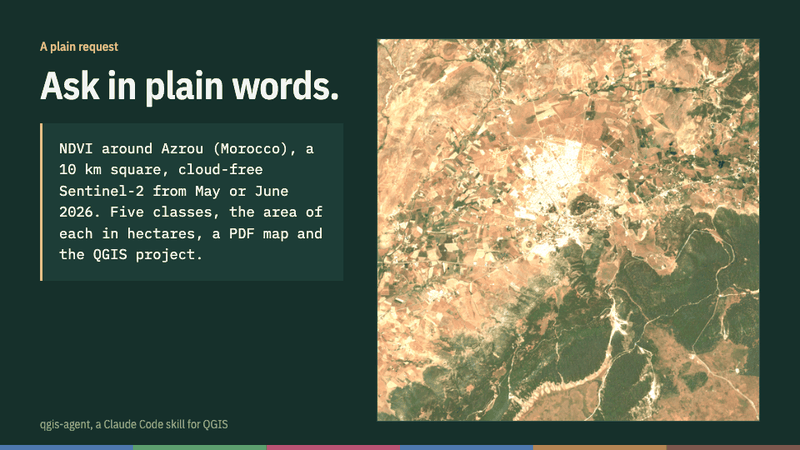

# qgis-agent

[](https://github.com/abdelaalimouid/qgis-agent/actions/workflows/tests.yml)
[](https://github.com/abdelaalimouid/qgis-agent/releases/latest)
[](LICENSE)

**An AI agent for QGIS that checks its own maps.** Website and gallery: [abdelaalimouid.github.io/qgis-agent](https://abdelaalimouid.github.io/qgis-agent/)

A Claude Code skill that teaches Claude a reliable way to work in QGIS: scope the request, get a plan approved, run each step as a numbered PyQGIS script, check the results, then hand back a factual work report, and write up the results when you ask. It is built for GIS and remote sensing work, from coursework to research and professional projects: Sentinel-2 imagery, spectral indices, classification, class areas, maps.



*A plain request, end to end: plan, download, NDVI, classes and areas, checks, finished map. Every frame is real output from a test run.*

## Install

You need Claude Code on your computer (the Claude desktop app's Code tab, or the terminal) and QGIS 3 or 4. Claude on the web cannot drive a QGIS installed on your machine.

### Option 1: as a plugin

In Claude Code:

```
/plugin marketplace add abdelaalimouid/qgis-agent
/plugin install qgis-agent@qgis-agent
```

Or in a terminal:

```bash
claude plugin marketplace add abdelaalimouid/qgis-agent
claude plugin install qgis-agent@qgis-agent
```

To move to a newer version later:

```bash
claude plugin marketplace update qgis-agent
claude plugin update qgis-agent@qgis-agent
```

### Option 2: by hand

1. Download [qgis-agent.zip](https://github.com/abdelaalimouid/qgis-agent/releases/latest/download/qgis-agent.zip), the latest version.
2. Unzip it into `~/.claude/skills/` (on Windows: `C:\Users\<your name>\.claude\skills\`). The file should end up here: `~/.claude/skills/qgis-agent/SKILL.md`.
3. Start a new Claude Code session.

You can also ask Claude Code to do it:

> Download https://github.com/abdelaalimouid/qgis-agent/releases/latest/download/qgis-agent.zip and unzip it into ~/.claude/skills/

## First run

Open Claude Code on your project folder and type:

> Use the qgis-agent skill: check that QGIS is detected, then propose a CLAUDE.md file for this project.

After that, just ask for what you want to do. You don't need to name the skill: Claude opens it by itself whenever a task involves QGIS or geographic data. It answers in your language.

## What the skill does

- It reads the assignment and the project rules, then inventories the data.
- It proposes a plan (steps, equivalent QGIS tools, projection, resolution, files created) and waits for your approval.
- It writes each step as a numbered, rerunnable script using QGIS's own tools (raster calculator, reclassify by table, zonal histogram, print layout), so you can redo every step by hand.
- It shows evidence: map previews, key figures, value ranges.
- It checks before handing over: projection, resolution, ranges, area totals, the project reopened from scratch.
- It hands back a factual work report: data, processing, results, checks, limits.
- On request, it writes the interpretation, a report or a paper draft from those results, with no figure the processing didn't produce and the limits kept visible.

By default it uses open data with no account: Sentinel-2 from the Earth Search catalogue, OpenStreetMap through the Overpass API.

### Network access

The data scripts need these hosts. If you run Claude Code in a sandbox or behind a firewall, allow them:

| Host | Used for |
|---|---|
| `earth-search.aws.element84.com` | Sentinel-2 catalogue |
| `e84-earth-search-sentinel-data.s3.us-west-2.amazonaws.com` | Sentinel-2 image files |
| `sentinel-cogs.s3.us-west-2.amazonaws.com` | Mirror of the image files, used with `--collection sentinel-2-l2a` |
| `overpass-api.de` | OpenStreetMap data |

If the image files can't be reached, the scripts stop with a clear message and point to the mirror. Both sources give identical reflectance.

## Contents

Everything is in [`skills/qgis-agent/`](skills/qgis-agent):

| File | Role |
|---|---|
| `SKILL.md` | The method, read by Claude |
| `scripts/qgis_python.sh` | Runs a script with QGIS's Python (macOS, Linux) |
| `scripts/pyqgis_template.py` | Headless PyQGIS step template |
| `scripts/s2_search.py` | Finds clear Sentinel-2 dates and measures clouds over the area itself |
| `scripts/s2_download.py` | Downloads bands as reflectance, for the needed extent only |
| `scripts/check_data.py` | Inventory and checks of rasters and vectors |
| `scripts/check_project.py` | Reopens a .qgz project from scratch and lists what it really contains |
| `references/` | Tested PyQGIS recipes, bands and indices, work report template |
| `assets/` | Project rules and request templates |

## Tested

- Automated tests for every change: Linux and macOS with QGIS 4.2 (conda-forge), and Windows with the official QGIS 3.44 installer through `python-qgis-ltr.bat`, the way most Windows users run it. They also pass on macOS with QGIS 3.44. They cover the Sentinel-2 reflectance rules, the data and project checkers, the step template and the PyQGIS recipes, each compared with an independent numpy calculation. A weekly job downloads real data from both image sources and checks they agree.
- A fresh agent, told nothing about the skill, received a request worded like a student's: NDVI around Azrou, five classes, class areas, a map and a QGIS project. It opened the skill by itself, proposed a plan, waited for approval, then produced everything in four minutes. An independent recalculation gives an identical NDVI, class areas within 0.02 %, and a project that reopens with no warnings.
- A second fresh agent, given a request written in French (NDBI and MNDWI on Khénifra), opened the skill by itself, answered in French and planned with the imagery rules: bundled download, reflectance, 20 m for the SWIR indices, full coverage of the area.
- The Sentinel-2 bands downloaded by the skill match those of a reference project (Ifrane forest) pixel for pixel.
- With the image host blocked, the scripts stop with a clear message, and the mirror collection gives the same reflectance as the default one (difference below 0.0000001). An earlier test agent that worked around a blocked host with its own code subtracted the offset twice; version 1.0.1 makes the scripts and the rules close that gap.
- The Windows job caught a real problem: QGIS's Windows launcher leaves the Processing plugin off the Python path. The step template now adds it. A first hands-on report from a Windows user is still welcome in the [Issues](https://github.com/abdelaalimouid/qgis-agent/issues).

## Contributing

Help is welcome, especially Windows testers, reports of wrong results, examples from your own area and new skills. See [CONTRIBUTING.md](CONTRIBUTING.md) and the [roadmap](ROADMAP.md): the next steps are skills for change detection, land cover classification and time series, then a benchmark that measures whether AI agents get GIS results right.

## Guide

The guide [Working with an AI agent in QGIS](docs/qgis-agent-guide.pdf) (10 pages) explains the method behind the skill: setting up the project, writing the request, the work cycle, checking without redoing everything, the work report and the write-up. It ends with a real work report from a Sentinel-2 project on the Ifrane forest.

## Cite

If this skill helps with a report or a paper, please cite it ("Cite this repository" button on the right):

> Mouid, A. (2026). *qgis-agent: a Claude Code skill for working in QGIS* (version 1.1.0) [software]. https://github.com/abdelaalimouid/qgis-agent

## Author

Abdelaali Mouid, Master 2 Data & AI, Institut National des Postes et Télécommunications (INPT), Rabat.

## Licence

MIT. Sentinel-2 data remains subject to the Copernicus terms, and OpenStreetMap data to the ODbL licence.

